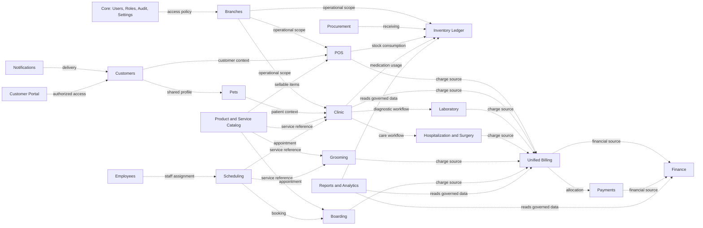

# ERD Konseptual PETORA INDONESIA

- Status: ERD konseptual untuk analisis; belum siap menjadi dasar DDL sampai cardinality dan ownership direview.
- Rujukan: [DATABASE_DESIGN.md](DATABASE_DESIGN.md) dan [MASTER_SPECIFICATION.md](MASTER_SPECIFICATION.md).

Diagram ini menunjukkan kelompok domain dan arah keterkaitan konseptual. Panah tidak menyatakan cardinality, foreign key, ownership final, atau transaction boundary. Relasi tersebut harus dikonfirmasi sebelum migration.

## Entitas Konseptual

| Domain | Konsep yang diketahui | Hal yang belum diputuskan |
|---|---|---|
| Core/Branches | User, role/permission, branch, audit, settings | Cardinality, role model, branch assignment, audit schema |
| Customers/Pets | Customer profile, pet profile, medical history reference | Field, duplicate resolution, guardian relationship, retention |
| Catalog/Inventory/Procurement | Product/service, warehouse, movement, batch, supplier, purchase order, receipt | Units, costing, status, partial receipt, physical schema |
| POS/Billing/Payments/Finance | Sale, invoice/item, payment/allocation, refund/reversal, financial record | Lifecycle, currency/tax, accounting scope, numbering |
| Clinic/Services/Scheduling | Appointment, encounter/record, lab, hospitalization, grooming, boarding | Clinical workflow, capacities, cardinality, resource model |
| Employees/Notifications/Portal/Reports | Employee, delivery, portal identity, report metric | Scope, consent, access, metrics, retention |

## Tinjauan Wajib Sebelum DDL

Konfirmasi cardinality dan ownership setiap relasi; identifiers; soft-delete/retention; immutable ledger needs; unique/idempotency keys; branch ownership; audit records; transaction boundary; query/index needs; serta data migration/backup implications. Tidak ada DDL atau destructive migration yang dihasilkan dari diagram ini.